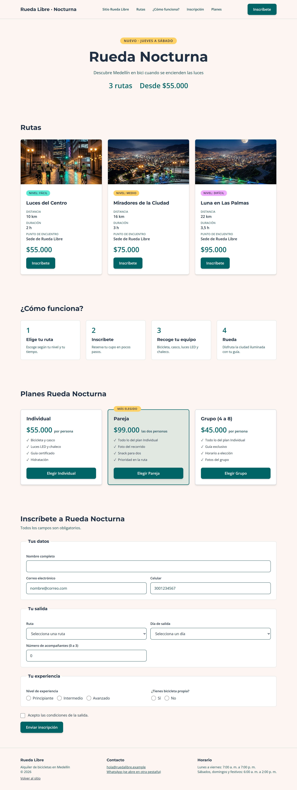
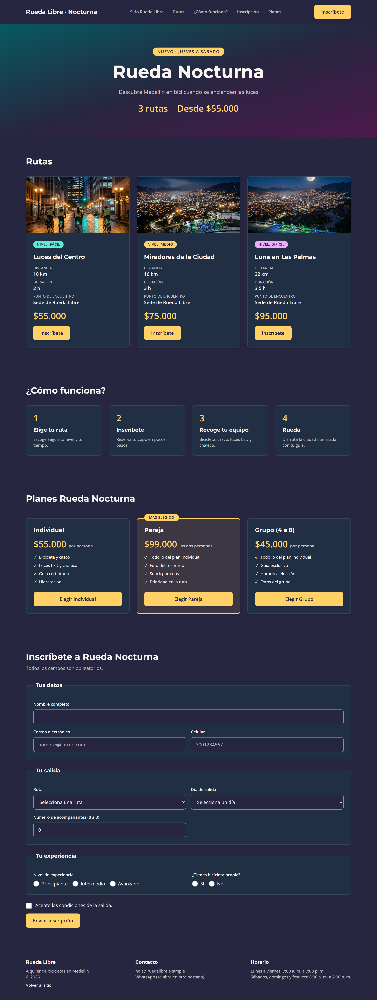

# Rueda Libre / Rueda Nocturna

Ecosistema web de **Rueda Libre**, un negocio de alquiler de bicicletas en
Medellín: un sitio informativo y la landing de la campaña **Rueda Nocturna**,
con recorridos guiados de noche de jueves a sábado.

## Enlaces publicados

- Sitio Rueda Libre: [nicolas-10-23.github.io/Ruta_Basica/rueda-libre](https://nicolas-10-23.github.io/Ruta_Basica/rueda-libre/)
- Landing Rueda; [nicolas-10-23.github.io/Ruta_Basica/rueda-libre/nocturna/index.html](https://nicolas-10-23.github.io/Ruta_Basica/rueda-libre/nocturna/index.html)
- Repositorio: [github.com/nicolas-10-23/Ruta_Basica](https://github.com/nicolas-10-23/Ruta_Basica)

## Páginas

| Página            | Ruta                          | Qué ofrece                                          |
| ------------------ | ----------------------------- | ---------------------------------------------------- |
| Inicio             | `index.html`                | Servicios, flota, beneficios y banner de la campaña |
| Tarifas y rutas    | `paginas/tarifas.html`      | Tablas de tarifas y recorridos                       |
| Reservas           | `paginas/reservas.html`     | Formulario validado y horario                        |
| Rueda Nocturna     | `nocturna/index.html`       | Landing: rutas, planes e inscripción                |
| Kit de componentes | `nocturna/componentes.html` | Botones, card, alertas e inputs                      |

## Tecnologías

- HTML5 semántico, formularios con validación nativa y accesibilidad.
- CSS propio (variables, Flexbox, Grid, mobile-first) en el sitio.
- Tailwind CSS 3 con CLI en la landing (tema en `tailwind.config.js`, modo
  oscuro por preferencia del sistema).
- Git, GitHub y GitHub Pages; Montserrat y Open Sans (Google Fonts).

## Recomendación de framework

Comparé la flota hecha con CSS propio y con Bootstrap 5 (`pruebas/`):
Bootstrap fue más rápido de armar (40 min frente a 90) y dio breakpoints y
tarjetas sin escribir CSS, pero llenó el HTML de clases y no respetó la
marca sin sobrescribirlo. Tailwind permite construir con la identidad
exacta de la marca y reutilizar componentes. **Recomendación:** Bootstrap
para prototipos y paneles internos; Tailwind (o CSS propio) cuando la marca
y el diseño a medida importan, como en esta campaña.

## Capturas

| Escritorio                                 | Celular                              | Modo oscuro                             |
| ------------------------------------------ | ------------------------------------ | --------------------------------------- |
|  |  |  |

## Aprendizajes

- Las rutas relativas y las mayúsculas importan más en GitHub Pages que en local.
- La especificidad de CSS explica por qué una clase "no funciona".
- Grid para dos dimensiones y Flexbox para una; mobile-first simplifica el responsive.
- Tailwind genera solo las clases usadas; el contraste se valida, no se supone.
- La validación del navegador mejora la experiencia, pero no es seguridad.

## Pendientes

- Conectar el formulario a un servidor (hoy `action="#"`; en Pages da 405).

## Autor

Nicolas Alzate Estrada
